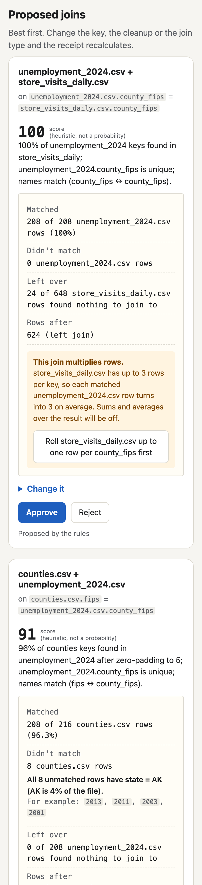
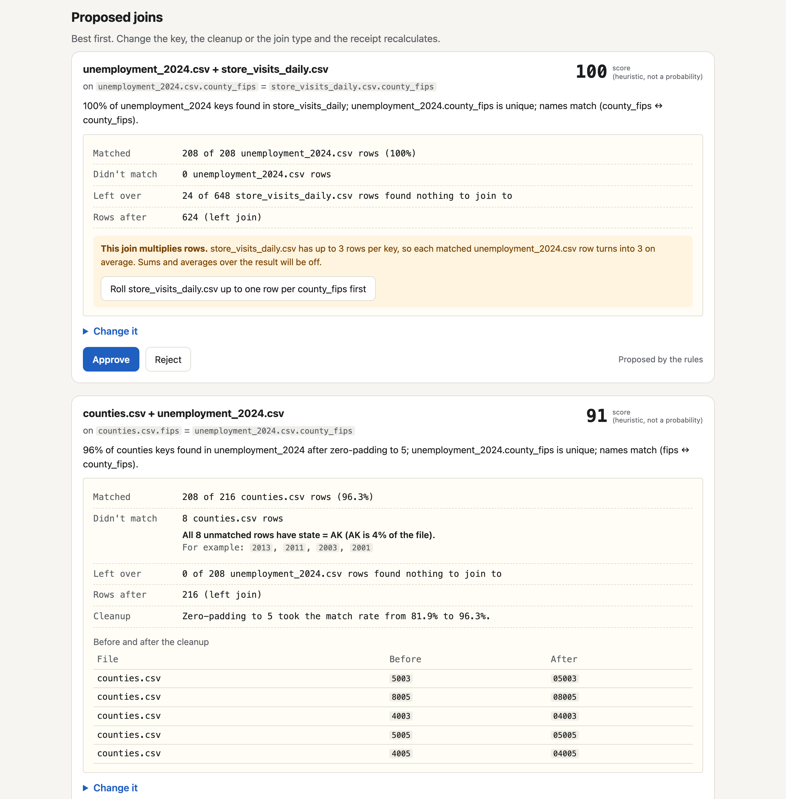
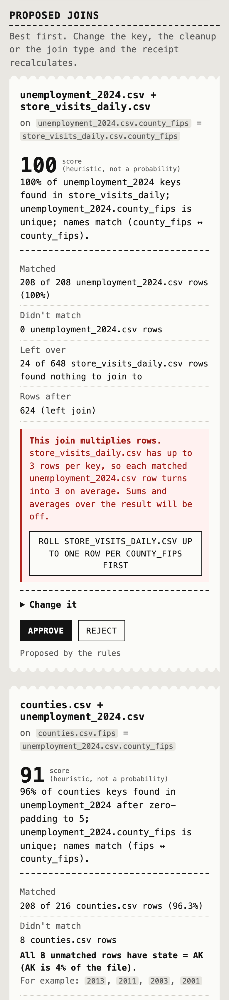
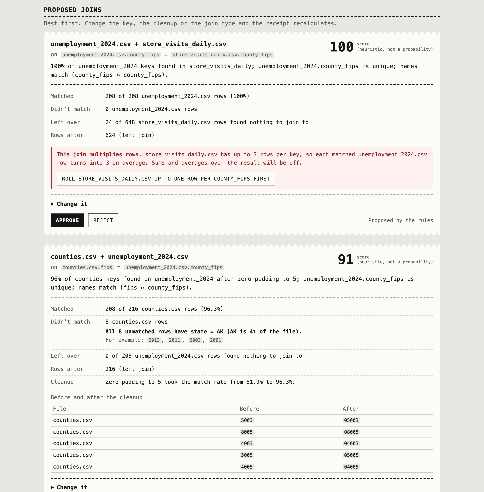
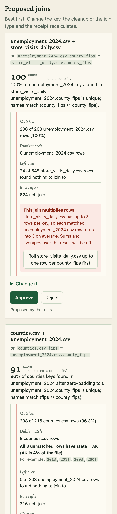
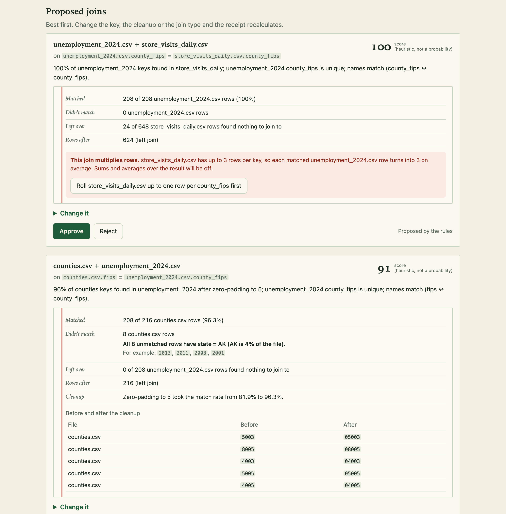
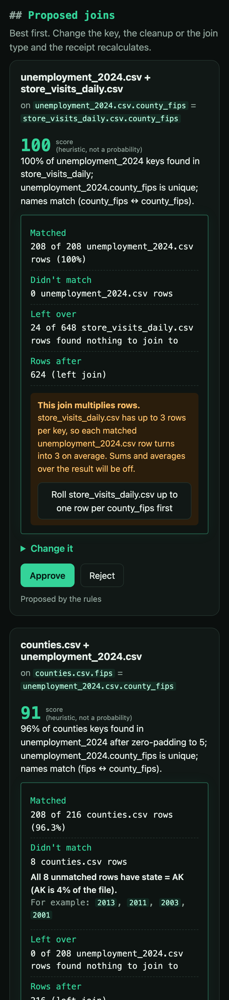
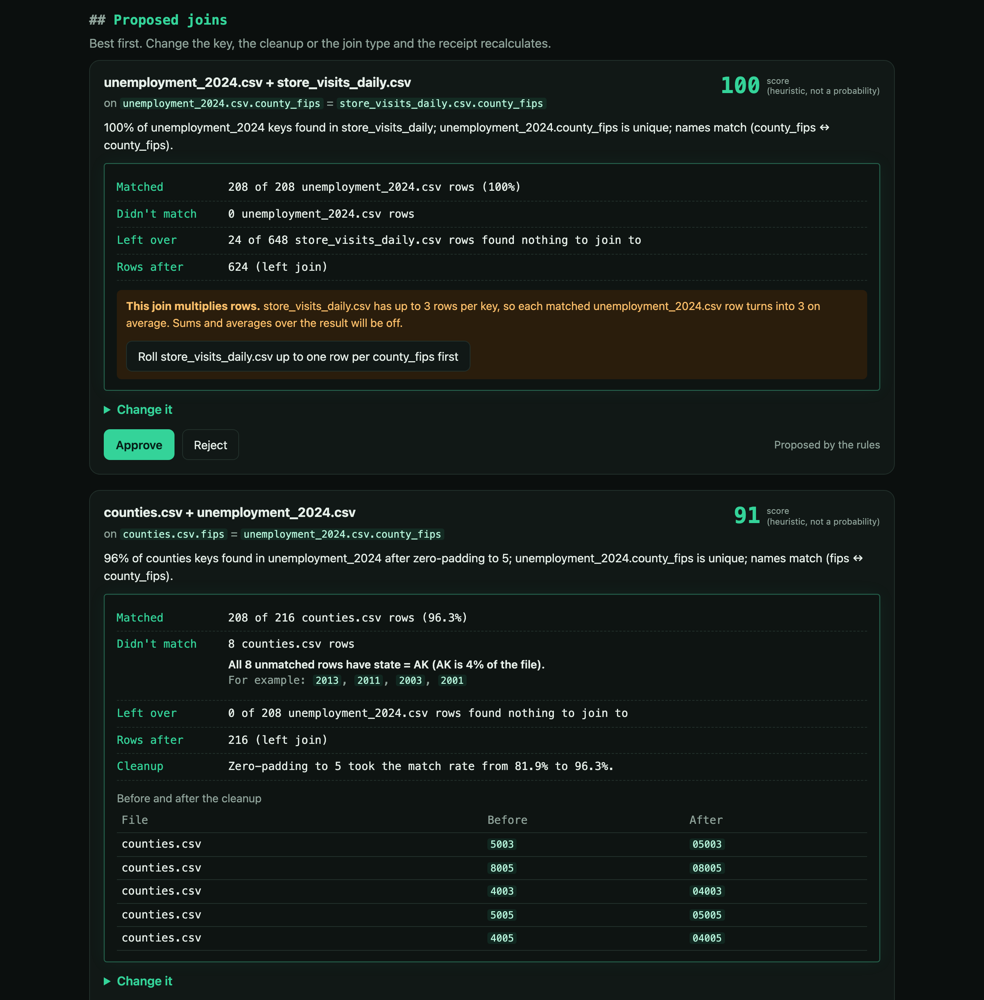

# Pick a look

Three skins over the same page, with the sample data loaded. Only colours, type and borders change; the layout and words are the same in all four. Try them live with `npm run dev` and `?sample=1&look=till`, `ledger` or `lab`.

| | Phone (390px) | Desktop (1280px) |
|---|---|---|
| **Now** (plain) |  |  |
| **A. Till**: the page is a thermal receipt. Monospace, torn edges, black ink, red only for problems. |  |  |
| **B. Ledger**: an accountant's book. Serif headings, cream paper, green rules, the red margin line. |  |  |
| **C. Lab**: pettigrewlab.com's dark ink and emerald, terminal headings. |  |  |

The tops of each page (title, file drop, file cards) are in the `*-top.png` files next to these.

Whichever one you pick moves into `styles.css` and gets a matching dark or light mode. This branch is for choosing and doesn't merge.
