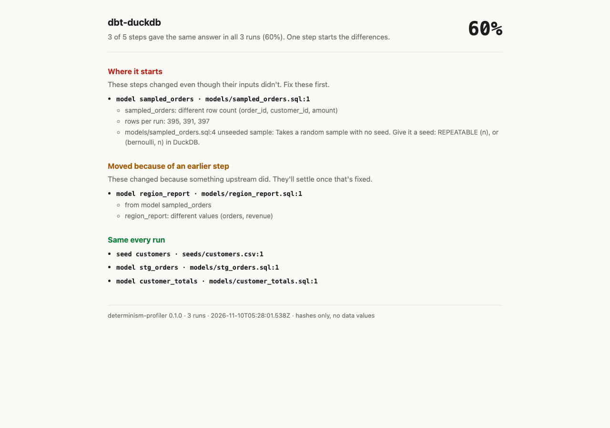

# Determinism Profiler

Run your analysis three times. See which steps give the same answer, and why the others don't.

It runs a Jupyter notebook, a folder of SQL, or a dbt project several times and compares what every step produced. Steps that always match are marked as the same. For the ones that moved, it tells you which step started it, which ones only moved because of that step, and the likely cause with file and line: a sample with no seed, a timestamp, a tie in a ranking, a LIMIT with no ORDER BY, a set iterated in whatever order Python feels like that day, or an AI step.

Nothing about your data leaves your machine. The report and traces hold hashes and row counts, never values or your code.

```bash
npx determinism-profiler analysis.ipynb
npx determinism-profiler sql/
npx determinism-profiler my_dbt_project/
```



## What you get

This is the SQL ties fixture: a table that arrives in a different order every run, then `ROW_NUMBER()` picks the best player per team when lots of players share the top score.

```

Determinism Profiler · sql-ties · 3 runs
2 of 4 steps gave the same answer in all 3 runs (50%). One step starts the differences.

Where it starts
These steps changed even though their inputs didn't. Fix these first.
  • table top_per_team · 03_top_per_team.sql:2
      top_per_team: different values (player_id)
      03_top_per_team.sql:6  ties: Sorts or ranks on columns that can tie, and which row wins a tie isn't defined. Add a tiebreaker (an id column) to the ORDER BY.

Moved because of an earlier step
These changed because something upstream did. They'll settle once that's fixed.
  • query · 04_report.sql:1
      from table top_per_team
      result: different values (player_id)

Could vary, didn't this time
These can give a different answer, but they matched in all 3 runs.
  • 02_shuffled.sql:3
      random numbers: Draws random numbers with no seed. Set a seed before the first draw.

Same every run
  ✓ table players · 01_players.sql:1
  ✓ table arrivals · 02_shuffled.sql:2
```

The order of `arrivals` changed every run, and that's fine: a table has no defined order, so the profiler counts it as the same input. The `ROW_NUMBER` step got the same rows and still picked different winners. That's the step to fix, and the report says so instead of flagging everything downstream of it.

It writes `report.html`, `report.md` (made to paste into a PR) and `report.json`, plus one trace per run, to `./.determinism`. Exit code `0` means every step matched, `1` means at least one didn't (so it works as a CI check), and `2` means it couldn't run.

## How it decides who to blame

A step is blamed only when its inputs were identical in every run and its output still changed. If an input changed, the step is listed under the step that started it. If a data file itself was different between runs, nothing gets blamed, because that isn't the code's fault. The reasoning is in [ADR 0006](../../docs/adr/0006-attribution-rule.md).

Notebooks need one extra trick. The cell that causes the trouble usually prints nothing (`sample = orders.sample(frac=0.5)`), so comparing cell output would blame a cell three steps later. The profiler runs a copy of your notebook with a hidden cell before and after each of yours that fingerprints the variables the cell reads and writes and the files it opens or saves. Your notebook isn't changed.

It also tells apart the kinds of change, because they don't all matter the same: same rows in a different order, a different row count, different values, or a change only in the last few digits of a decimal (adding numbers in a different order does that).

## Options

| Option | What it does |
|---|---|
| `--runs N` | How many runs (default 3) |
| `--cells 2,4-6` | Notebook: just these cells, plus the cells they need and any setup cells (imports, seeds) |
| `--select NAMES` | SQL: these files or tables and what they read from. dbt: passed to `dbt --select`, so `state:modified+` works; a bare model name means `+name` |
| `--static-only` | Read the code for the usual causes and run nothing |
| `--fail-on never` | Always exit 0 |
| `--out DIR` | Where the report goes (default `./.determinism`) |
| `--jupyter`, `--kernel`, `--dbt`, `--duckdb-path` | Point it at your tools when they aren't on your PATH |

## What it needs

- Node 22 or newer.
- For notebooks: your own Jupyter (`jupyter nbconvert` and a kernel). It runs your notebook with your kernel and your packages, because that's what you're trying to check. See [ADR 0007](../../docs/adr/0007-no-bundled-python.md).
- For dbt: dbt with the **dbt-duckdb** adapter. Every run is `dbt build --full-refresh`, since otherwise runs two and three would test your incremental logic instead. Other adapters get `--static-only` for now.
- For SQL: nothing. It runs in DuckDB, fresh for every run.

## What it checks in the code

| Cause | SQL | Python |
|---|---|---|
| Current time | `now()`, `current_timestamp`, `current_date` | `datetime.now()`, `pd.Timestamp('now')`, `time.time()` |
| Random numbers | `random()`, `uuid()` with no `setseed` | `np.random.*`, `random.*` with no seed; `default_rng()` |
| Sample with no seed | `USING SAMPLE`, `TABLESAMPLE` without a seed | `.sample()` without `random_state`, `train_test_split`, unseeded sklearn models |
| Set order | `string_agg`, `list`, `array_agg` with no `ORDER BY`; `first()`, `any_value()` | `list(set(...))`, `', '.join(set(...))` |
| Ties | `ROW_NUMBER() OVER (... ORDER BY ...)`, `ORDER BY ... LIMIT` | `.sort_values().head()`, `nlargest()` |
| LIMIT with no ORDER BY | yes | |
| Adding order | seen at run time, when only the last digits move | same |
| AI steps | | OpenAI, Anthropic, Gemini, Ollama, LiteLLM calls (reported apart, not scored) |

A finding is **confirmed** when its step was the one that started a difference. If the step matched in every run, it's listed under "could vary, didn't this time", which is the honest answer: DuckDB happens to return the same rows for a small `LIMIT 5` every time, but nothing promises it. Ties and unordered limits only matter when the columns can tie, so they sit in a quieter "worth a look" section unless a run proves them.

## How well it works

Fourteen fixtures in [`fixtures/determinism-profiler`](../../fixtures/determinism-profiler), each with the answer it should give. `npm run accuracy` runs them all three times and writes [`accuracy.json`](../../fixtures/determinism-profiler/accuracy.json); CI fails if the numbers change.

| | |
|---|---|
| Planted causes found and confirmed | 12 of 12 |
| Fixtures where the blame landed on the right step | 14 of 14 |
| Causes reported on the clean fixtures | 0 |

That same million-row test turned up something none of the fixtures had to fake: a plain `GROUP BY g` with `sum(x)` over a million doubles gave different last digits between runs, because DuckDB adds in parallel. The profiler reported it as a change in the last few digits, not as wrong numbers.

A test plants made-up values in the data, in SQL and code literals, in a failing `CAST` and in a cell that raises on one, then checks that none of them shows up in anything the profiler writes.

## Limits in this version

- A notebook cell that changes a variable it never names (a function that mutates a global) isn't seen. Calling a notebook function that reads a variable is handled.
- Images and widgets in cell output aren't compared.
- dbt views are re-run when read, so a random view's fingerprint can differ from what the next model saw. Tables are exact.
- Big tables are fingerprinted row by row in Node. A million-row table took about 4.5 seconds a run on a MacBook (13.5 seconds for three runs, 316 MB of memory). That's fine for analysis-sized data and slow for a warehouse.

## Develop

```bash
cd packages/determinism-profiler
npm install
python3.12 -m venv .venv && .venv/bin/pip install nbconvert ipykernel pandas numpy dbt-core dbt-duckdb
npm test            # unit tests, plus notebook and dbt tests when .venv has jupyter and dbt
npm run accuracy    # all fixtures, three runs each
npm run build       # dist/cli.js
```

Design: [PRD](../../docs/specs/2026-11-09-determinism-profiler-prd.md) · [value statements](../../docs/specs/2026-11-09-determinism-profiler-value.md) · [v1 design](../../docs/specs/2026-11-09-determinism-profiler-v1-design.md) · reviews of [the value](../../docs/reviews/2026-11-09-determinism-profiler-value-review.md) and [the design](../../docs/reviews/2026-11-09-determinism-profiler-spec-review.md).
